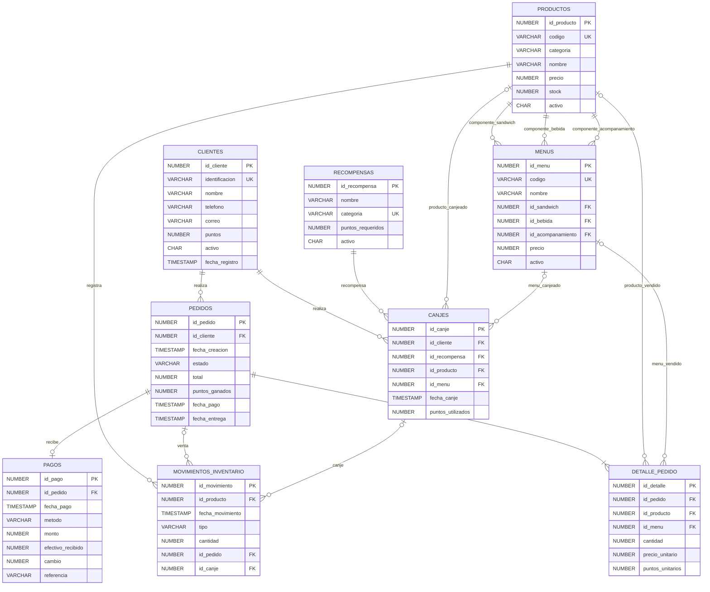

# Diagrama entidad-relación

El modelo usa nueve tablas. Un detalle de pedido referencia exactamente un producto o un menú; un canje referencia exactamente un producto o un menú. Los movimientos de inventario se asocian a una reposición, una venta o un canje.

